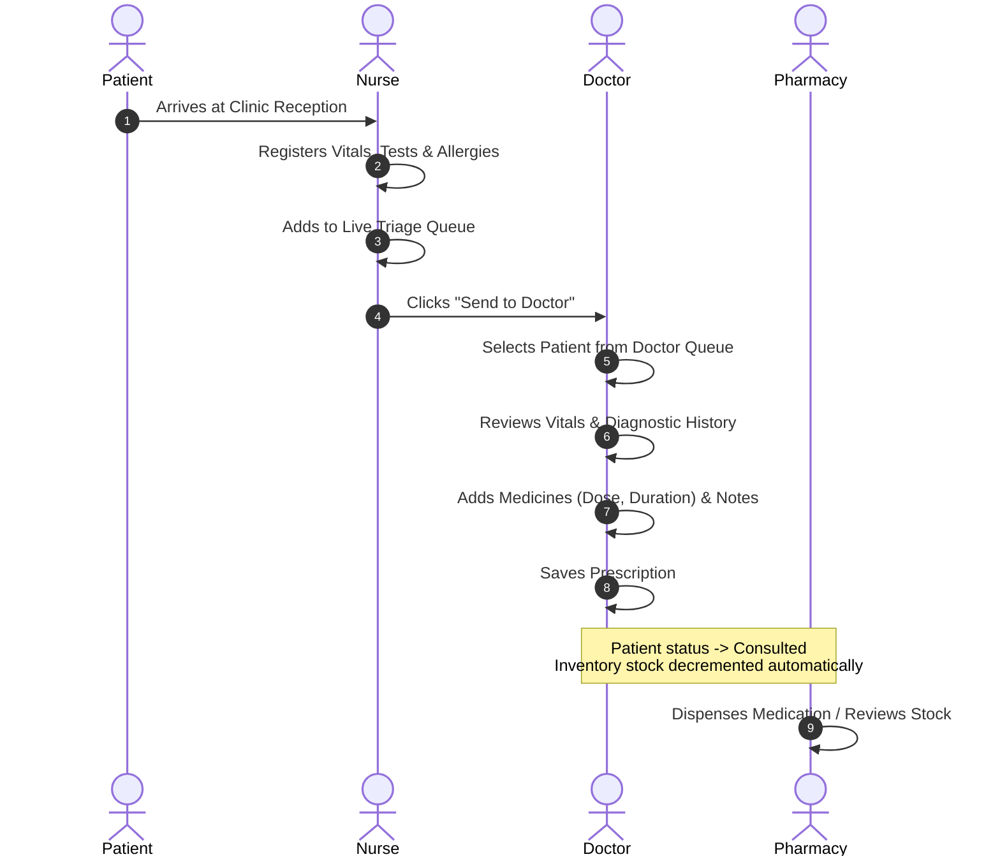

# 🧬 HELIX — Clinical Workflow System

[](#)
[](#)
[](#)
[](#)
[](#)

> **HELIX** is a lightweight, responsive, role-based Clinical Workflow and Outpatient Department (OPD) Management System designed to streamline patient intake, triage queues, physician consultations, electronic prescribing, and pharmacy stock dispensing.

---

## 📖 Table of Contents

- [Overview](#-overview)
- [Key Features by Role](#-key-features-by-role)
  - [👩‍⚕️ Nurse Workstation](#1-nurse-workstation-triage--queue)
  - [👨‍⚕️ Doctor Workstation](#2-doctor-workstation-consultation--prescription)
  - [🏥 Medical Staff / Pharmacy](#3-medical-staff--pharmacy-dispensing)
  - [⚙️ Administrator Dashboard](#4-administrator-dashboard--system-controls)
- [Demo Credentials & Access Control](#-demo-credentials--access-control)
- [Architecture & Tech Stack](#-architecture--tech-stack)
- [Repository Structure](#-repository-structure)
- [Getting Started](#-getting-started)
- [Clinical Workflow Lifecycle](#-clinical-workflow-lifecycle)
- [Git & Collaboration Workflow](#-git--collaboration-workflow)
- [Roadmap](#-roadmap)
- [Contributing & License](#-contributing--license)

---

## 🌟 Overview

Modern outpatient clinics often suffer from fragmented communication between triage desks, consultation rooms, and on-premise dispensaries. **HELIX** bridges this gap by providing an integrated single-page workstation tailored for four distinct healthcare personas:

1. **Nurses** quickly register incoming patients and monitor color-coded queue waiting times.
2. **Doctors** review vital signs, diagnostic test history, and allergies while drafting electronic prescriptions with automatic stock verification.
3. **Pharmacy / Medical Staff** manage medicine stock, filter inventory across clinical departments, and handle fast unit dispensing.
4. **Clinic Administrators** track facility metrics, add new pharmaceutical products, and test system workflows using role-switching capabilities.

HELIX operates entirely with zero backend setup required out of the box—leveraging modern browser storage (`localStorage`) seeded with clinical demo datasets for instant deployment and testing.

---

## 🚀 Key Features by Role

### 1. 👩‍⚕️ Nurse Workstation (Triage & Queue)
- **Patient Registration & Vitals Intake**: Records demographic data (name, age, gender, contact number, weight, height) alongside critical vitals (Blood Pressure, Sugar level, Temperature).
- **Clinical History & Allergies**: Logs prior medical history, conducted tests (Blood, Urine, X-Ray, ECG, CT Scan, MRI), and drug allergy warnings with high-visibility badges.
- **Dynamic Queue & SLA Tracking**: Live patient queue with automated wait-time tracking:
  - 🟢 **< 30 minutes**: Standard waiting duration.
  - 🟡 **30 minutes – 2 hours**: Moderate wait alert.
  - 🔴 **> 2 hours**: High wait-time escalation.
- **Physician Handoff**: One-click dispatch (`Send to Doctor`) moves patients directly to the consulting physician's intake list.

### 2. 👨‍⚕️ Doctor Workstation (Consultation & Prescription)
- **Queue Review**: Displays patients handed off by nursing staff ready for consultation.
- **Patient Health Snapshot**: Displays a clinical vitals board, existing medical conditions, and allergy warnings before prescribing.
- **Interactive Prescription Builder**:
  - Select medicines from the clinic's real-time pharmacy inventory with Department and MRP info.
  - Configure dosage intervals (`1-0-1 After Food`, `1-0-0 Morning`, `SOS`, etc.) and treatment durations (e.g. `5 Days`).
  - Itemized table with instant removal controls.
- **Clinical Notes & Advice**: Field for doctor's instructions, dietary guidance, or follow-up timelines.
- **Automated Stock Deduction**: Saving a completed prescription automatically transitions the patient status to `consulted` and decrements available inventory in the pharmacy.

### 3. 🏥 Medical Staff / Pharmacy (Dispensing)
- **Departmental Filtering**: Quick-filter catalog across clinical branches:
  - `Cardiology`, `Dermatology`, `General`, `Orthopedics`, and `Pediatrics`.
- **Live Search**: Instant text filtering by drug name, active strength, or pharmaceutical manufacturer.
- **Stock Threshold Badges**: Automatic visual indicators for low-stock items ($\le 30\text{ units}$) versus healthy stock.
- **Rapid Dispensing Controls**: Quick-action buttons to dispense single or batch units (`-1`, `-5`) or restock inventory (`+1`).

### 4. ⚙️ Administrator Dashboard & System Controls
- **Operational Metrics**:
  - 📋 Waiting Queue count
  - 🩺 Completed prescriptions
  - 💊 Total pharmaceutical catalog items
  - 👥 Total registered patients
- **Medicine Catalog Registration**: Form to register new drugs with Department, Strength, Manufacturer, MRP (₹), and Initial Stock.
- **Role Preview Bar**: Dedicated administrator-only toolbar allowing instant switching between Doctor, Nurse, Medical Staff, and Admin views without repeated re-authentication.
- **Demo Data Reset**: Instant rollback button to restore pristine sample patients and pharmaceutical inventory.

---

## 🔐 Demo Credentials & Access Control

HELIX provides pre-configured role accounts for immediate testing:

| Role | Username | Password | Assigned Staff | Permissions |
| :--- | :--- | :--- | :--- | :--- |
| **Doctor** | `doctor` | `doctor` | Dr. Alexander Brooks | Consultation, vitals review, prescription builder, pharmacy stock sync |
| **Nurse** | `nurse` | `nurse` | Nurse Emily Davis | Patient intake registration, vitals recording, live queue management |
| **Medical Staff** | `medical` | `medical` | Staff Michael Ross | Pharmacy catalog, departmental filter, unit dispensing & restock |
| **Administrator** | `admin` | `admin` | Admin Clara Vance | Clinic statistics, add medications, demo data reset, multi-role preview |

> **Tip:** You can log in via manual credentials or use the 1-click role buttons on the Sign In screen.

---

## 🏗️ Architecture & Tech Stack

```
   ┌─────────────────────────────────────────────────────────────┐
   │                       HELIX CLIENT                          │
   │                                                             │
   │   ┌────────────────┐   ┌────────────────┐   ┌───────────┐   │
   │   │   index.html   │   │   styles.css   │   │  data.js  │   │
   │   │  Semantic View │   │ Design System  │   │ Seed Data │   │
   │   └───────┬────────┘   └────────────────┘   └─────┬─────┘   │
   │           │                                       │         │
   │           ▼                                       ▼         │
   │   ┌─────────────────────────────────────────────────────┐   │
   │   │                       app.js                        │   │
   │   │   - State Engine (Patients, Catalog, Prescriptions) │   │
   │   │   - Role-Based Screen & Navigation Router           │   │
   │   │   - Triage Queue & Wait Time Calculations           │   │
   │   │   - Prescription & Real-time Stock Sync             │   │
   │   └──────────────────────────┬──────────────────────────┘   │
   │                              │                              │
   │                              ▼                              │
   │              ┌───────────────────────────────┐              │
   │              │ Browser LocalStorage / Memory │              │
   │              └───────────────────────────────┘              │
   └─────────────────────────────────────────────────────────────┘
```

- **Frontend**:
  - **HTML5**: Accessible markup organized into tabbed, role-gated `<section class="screen-view">` modules.
  - **CSS3 Design System**: Custom styling using CSS variables (`--primary`, role color tokens), Google Font *Inter*, flexbox/grid layouts, responsive cards, and notification toast animations.
  - **Vanilla JavaScript (ES6+)**: Centralized reactive state store, dynamic DOM rendering, sanitization helpers (`escapeHtml`), and event delegation.
- **Data Persistence**:
  - Web Storage API (`localStorage`) with fallback initialization from `data.js`.
  - Keys: `helix_patients`, `helix_medicines`, `helix_prescriptions`, `helix_current_user`.
- **Package Management & Tooling**:
  - `Node.js` & `npm` configuration (`package.json`, `package-lock.json`).
  - `express` dependency available for backend extensions.

---

## 📁 Repository Structure

```text
HELIX/
├── index.html          # Main application markup & multi-role view templates
├── styles.css          # Design system, theme variables, and component styles
├── app.js              # Core application logic, routing, queue, & prescription engine
├── data.js             # Initial mock dataset (medicines, test patients, credentials)
├── config.txt          # Configuration metadata used for Git conflict simulation
├── package.json        # Project metadata, dependencies, and script definitions
├── package-lock.json   # Deterministic npm dependency lockfile
├── .gitignore          # Repository ignore rules
└── README.md           # Project documentation and workflow guidelines
```

---

## 💻 Getting Started

### Prerequisites

- Any modern web browser (Google Chrome, Firefox, Safari, Microsoft Edge).
- *(Optional)* [Node.js](https://nodejs.org/) (v16+) and `npm` if running a local development server.

### Running the Application

#### Option 1: Direct Browser Launch (Zero Install)
Simply open `index.html` directly in your browser:
```sh
# On macOS
open index.html

# On Linux
xdg-open index.html

# On Windows
start index.html
```

#### Option 2: Using a Lightweight Static Server (Recommended)
Running via an HTTP server ensures full compatibility with browser storage and local assets:

```sh
# Using npx (Node.js required)
npx serve .

# Or using Python 3
python3 -m http.server 3000
```
Then navigate to `http://localhost:3000` in your web browser.

---

## 🔄 Clinical Workflow Lifecycle



---

## 🔀 Git & Collaboration Workflow

This repository serves as both a functional clinical prototype and an educational model for disciplined Git collaboration in software engineering.

### Branching Standard

| Branch | Purpose |
| :--- | :--- |
| `main` | Production-ready, stable codebase. |
| `feature/<name>` | New clinical features or interface improvements. |
| `docs/<name>` | Documentation revisions and architecture guides. |
| `fix/<name>` | Bug fixes and data validation patches. |

### Feature Branch Lifecycle

1. **Pull the latest changes**:
   ```sh
   git switch main
   git pull origin main
   ```

2. **Create a topic branch**:
   ```sh
   git switch -c feature/patient-vitals-validation
   ```

3. **Stage, inspect, and commit changes**:
   ```sh
   git status
   git diff
   git add app.js
   git commit -m "feat(nurse): add validation bounds for systolic and diastolic BP"
   ```

4. **Publish branch and open a Pull Request**:
   ```sh
   git push -u origin feature/patient-vitals-validation
   ```

### Merge Conflict Resolution Demonstration

As demonstrated in commits resolving changes in [`config.txt`](file:///Users/bhavesh/Desktop/PROJECTS/HELIX/config.txt), contributors practice standard conflict resolution workflows:
```sh
git checkout main
git merge feature-branch
# In case of CONFLICT:
git status
# Open affected files, resolve markers (<<<<<<<, =======, >>>>>>>)
git add config.txt
git commit -m "fix: resolve configuration conflict between contributors"
```

---

## 🗺️ Roadmap

- [ ] **REST API & Database Persistence**: Replace `localStorage` with an Express API backed by MongoDB or PostgreSQL.
- [ ] **PDF Export**: Generate downloadable, printable clinical prescription slips with clinic branding.
- [ ] **SMS / Email Alerts**: Send patient queue notifications and medicine refill reminders.
- [ ] **Role Authentication**: Implement secure JWT or session-based authentication with bcrypt password hashing.
- [ ] **Multi-Doctor Scheduling**: Support multiple active physicians and specialty triage routing.

---

## 📄 License & Attribution

This project is licensed under the [ISC License](file:///Users/bhavesh/Desktop/PROJECTS/HELIX/package.json).

Developed collaboratively as part of the **HELIX Clinical Workflow & Software Engineering** initiative.
